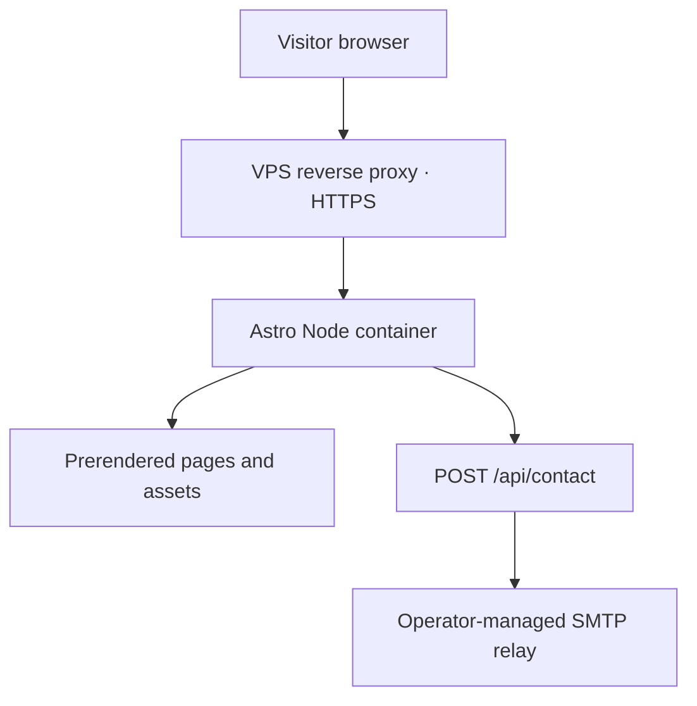

# Immobiliare Centotorri — Repository architecture

## Deployment decision

Run Astro with TypeScript and SCSS in a Node.js Docker container on a privately managed VPS. Prerender the website pages; execute only the contact and health endpoints at request time. Use the official Node adapter in standalone mode.

This supersedes the earlier static-only hosting and hosted-form proposal. There is no dependency on Vercel, Netlify, Sites hosting, managed functions, hosted forms, hosted CMS, hosted database, or third-party CAPTCHA service.

## Runtime topology



The reverse proxy terminates TLS and forwards requests to the application. Reuse the VPS's existing proxy if available; provide a self-hosted Caddy Compose profile for a fresh host. Only the proxy exposes public ports. The application serves both built assets and API routes, avoiding a separate backend service.

Email uses an operator-managed SMTP relay reachable from the container. SMTP configuration is deployment-specific; do not assume a third-party email API or include a mail server inside the web container. If the VPS has no mail transport, that is an explicit deployment prerequisite. Successful SMTP acceptance is not proof of inbox delivery.

## Repository layout

```text
immobiliare-centotorri/
  AGENTS.md
  README.md
  docs/
    architecture.md
    deployment.md
    content-editing.md
  public/
    brand/
    fonts/
    robots.txt
  src/
    assets/
      agency/
      properties/<slug>/
    pages/
      index.astro
      servizi.astro
      immobili/
        index.astro
        [slug].astro
      contatti.astro
      privacy.astro
      404.astro
      api/contact.ts
      healthz.ts
    layouts/
      BaseLayout.astro
    lib/
      ui/
        genericSection/
        genericSectionHeader/
        genericHero/
        genericButton/
        genericCard/
        genericCTA/
        genericChips/
        genericForm/
      components/
        header/
        footer/
        propertyCard/
        propertyGrid/
        propertyFilters/
        propertyGallery/
        propertyDetails/
        contactForm/
      styles/
        index.scss
        tokens/
          _variables.scss
          _breakpoints.scss
          _theme.scss
        base/
          _reset.scss
          _typography.scss
          _accessibility.scss
        utilities/
          _display.scss
          _flex.scss
          _grid.scss
          _spacing.scss
          _dimensions.scss
          _position.scss
          _overflow.scss
          _colors.scss
          _radius.scss
      data/
        agency.ts
        navigation.ts
        home.ts
        services.ts
        properties/
          index.ts
          <slug>.ts
      types/
        property.ts
        agency.ts
        service.ts
      utils/
        format.ts
        properties.ts
      server/
        env.ts
        contact/
          schema.ts
          service.ts
          mailer.ts
          rate-limit.ts
  tests/
    content.test.ts
    contact.test.ts
    e2e/
  infra/
    docker/
      Dockerfile
    caddy/
      Caddyfile
  compose.yaml
  compose.proxy.yaml
  scripts/
    validate-content.ts
  astro.config.mjs
  tsconfig.json
  package.json
  package-lock.json
  .dockerignore
  .gitignore
  .env.example
```

The layout is a target, not a requirement to create empty scaffolding. Each implemented UI/component directory contains a PascalCase `.astro` component and its camelCase `.module.scss`; interactive components may have a small colocated TypeScript script. `docs/architecture.md` is the repository destination for this document.

## Decisions and rationale

| Decision | Reason |
| --- | --- |
| Astro default static rendering with a Node adapter | Content stays prerendered while two small endpoints run in the same process. |
| `prerender = false` on contact and health endpoints | POST processing and live health checks must execute at runtime. |
| zkit utilities, following zspinach's evolved conventions | Preserves the owner's layout vocabulary and corrected utility behaviour. |
| Astro versions of generic components | Preserves reusable interfaces without requiring React and Motion for ordinary markup. |
| SCSS modules plus one global stylesheet | Utility composition remains consistent; component appearance stays local. |
| Typed local content files | Simple reviewable updates; no database or CMS infrastructure. |
| Dedicated property components | Real-estate fields stay outside reusable generic primitives. |
| Same-origin contact endpoint and SMTP | Self-hosted delivery path with credentials confined to server runtime. |
| One application replica initially | Sufficient for this scope; permits a bounded in-memory rate limiter with documented restart limitations. |
| Immutable multi-stage Docker image | Reproducible deployment, smaller runtime, and straightforward rollback. |
| Self-hosted reverse proxy | Central HTTPS termination and controlled public exposure. |

## Rendering and dependencies

Use `output: 'static'` with `@astrojs/node` configured for standalone mode and explicitly opt runtime endpoints out of prerendering. Confirm syntax against the installed compatible Astro/adapter versions; do not use obsolete `output: 'hybrid'` configuration.

Expected dependencies are Astro, the Node adapter, sitemap support, a maintained SMTP client, Sass, TypeScript, and the checking/testing tools actually used. Pin supported compatible versions through the committed lockfile. Start with no React, Svelte, Motion, RxJS, UI kit, database, or client router dependency.

Browser code progressively enhances mobile navigation, property filters, gallery controls, and form feedback. Main content, links, and property cards remain usable without it. A normal form POST remains supported.

## Styling and content

`BaseLayout.astro` imports `styles/index.scss` once. Sass variables and mixins supply compile-time values; semantic CSS custom properties supply runtime theme values. Global utilities handle spacing and composition; local modules handle appearance and responsive details. Tokens imported by modules must emit no CSS.

Use the zspinach spacing mapping consistently. Preserve its authoring vocabulary while replacing its software-themed visuals with the agency's design. Adapt known inherited issues: document height constraints, width utilities that implicitly change positioning, and focus suppression.

One typed file per property supplies its slug, copy, location, transaction, status, EUR price or price-on-request, dimensions, features, and imported images with alt text. Generate detail routes from those records. Keep agency identity and contact details in one file. Italian is the initial language; format currency and measurements accordingly. Rebuild the image after content changes.

## Contact and operations

Validate payload size and field values on the server. Use a fixed recipient and sender from server configuration, with the visitor's validated email as Reply-To. Apply bounded rate limiting, a honeypot, and same-origin request checks; send plain-text email or safely escaped HTML. Do not log message bodies or credentials.

Inject SMTP settings and secrets at runtime, outside the image and Git. Pass only public site origin and other intentionally public build values during the build. The application runs as a non-root user with a production entry point, health check, graceful shutdown, and restart policy. No production source bind mount is needed.

Keep HTML revalidatable and cache fingerprinted assets for a long lifetime. Do not cache contact responses. Persist proxy certificate state when the bundled proxy is used. Retain the previous release image for rollback; do not prune proxy volumes or unrelated workloads.

The first implementation must document the actual production commands, environment variables, proxy arrangement, SMTP prerequisite, and rollback procedure. Validate the production container locally before an authorized VPS release. DNS, host access, domain, SMTP credentials, and existing proxy configuration remain operator inputs, not values to invent.

## Technical references

- https://docs.astro.build/en/guides/integrations-guide/node/
- https://docs.astro.build/en/guides/on-demand-rendering/
- https://github.com/notzSph/zkit
- https://github.com/notzSph/zspinach (private; access required)
